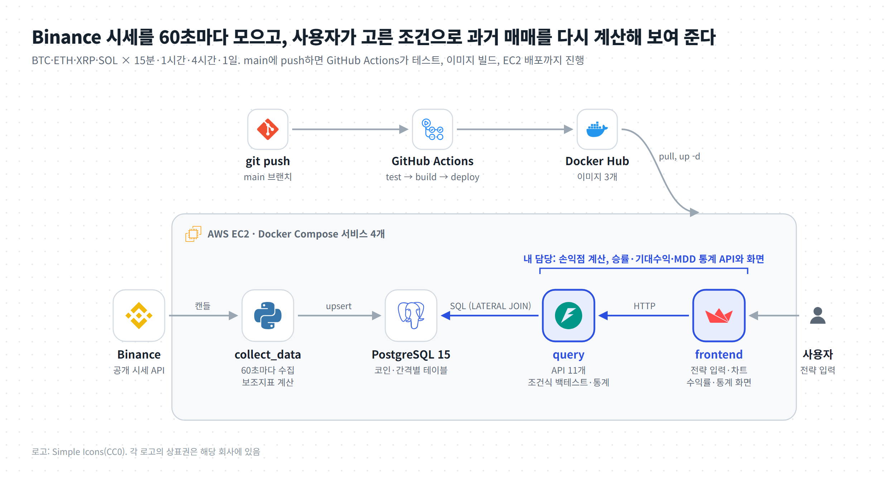
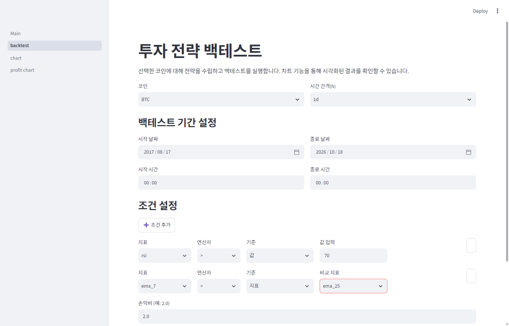
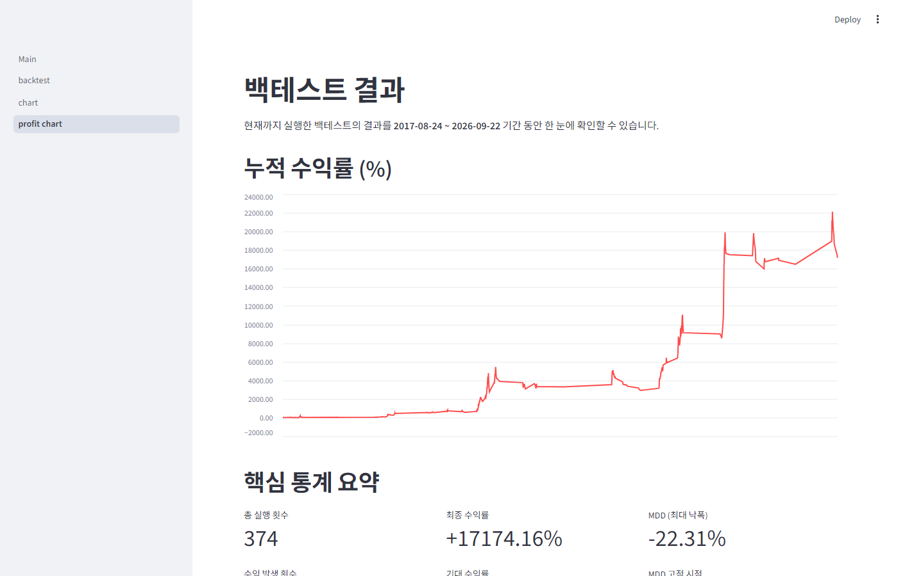
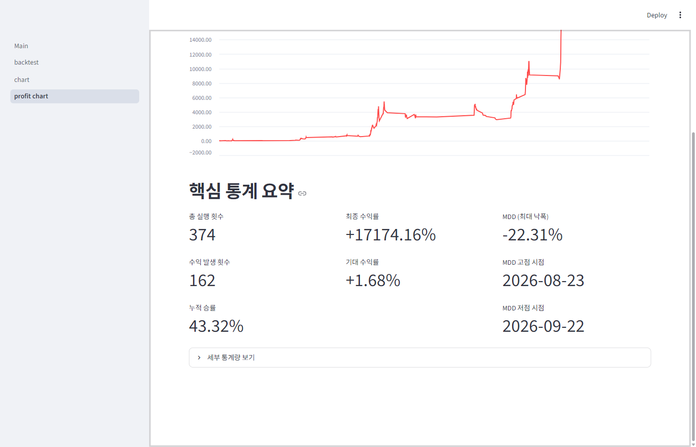
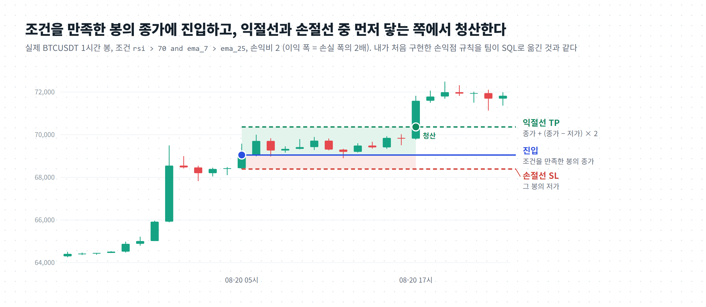

# Dev5ps ― 암호화폐 데이터 수집 · 전략 백테스트 플랫폼

> Binance에서 암호화폐 시세(OHLCV)를 계속 모아 PostgreSQL에 저장하고, 사용자가 화면에서 고른 **보조지표 조건(예: `rsi > 70 and ema_7 > ema_25`)과 손익비**로 "과거에 이렇게 샀다면?"을 계산해 **수익률 · 승률 · 기대수익 · MDD**를 보여 주는 웹 서비스입니다.
> 기간: 2025.03 – 2025.06 (최종 발표 2025-06-20) · 「오픈소스를 이용한 SW 개발 실습」 수업 팀 프로젝트 · **5조, 5인 팀**
> 이 저장소는 팀 저장소 [Rth2608/Dev5ps](https://github.com/Rth2608/Dev5ps)의 포크입니다. 팀 코드는 그대로 두고 README와 `docs/`(분석·설명·검증 문서, 웹 데모)를 추가했습니다(실행을 위해 `sqlalchemy<2.1` 버전 고정만 바꿈). 팀의 원래 README는 [docs/original_README.md](docs/original_README.md)에 있습니다.

> **그림으로 먼저 보기: [00_ELI5_저장소설명.pdf](00_ELI5_저장소설명.pdf)** (4쪽, 처음 보는 사람을 위한 그림 설명. GitHub에서 바로 열림)
>
> **웹 데모: [백테스트 바로 해 보기](https://sjzzang776.github.io/Dev5ps/demo/)** · 조건식과 손익비를 바꿔 가며 팀 규칙 그대로 계산
>
> **코드 구조 대시보드: [온라인으로 보기](https://sjzzang776.github.io/Dev5ps/dashboard/)** · [내 컴퓨터에서 보는 법](#내-컴퓨터에서-보기)

---

## 한눈에 보기

| 항목 | 내용 |
|---|---|
| 문제 | 감으로 하는 투자는 위험하다. 매매 전략이 과거 데이터에서 실제로 통했는지 **숫자로 확인**할 수단이 필요하다 |
| 해결 | 시세 수집(Binance) → 저장(PostgreSQL) → 조건식 백테스트(FastAPI + SQL) → 시각화(Streamlit)를 Docker Compose 4개 서비스로 구성하고 GitHub Actions로 테스트·빌드·배포 자동화 |
| 결과(발표 시점) | 예시 전략으로 2017-08-17 ~ 2025-06-11 구간 백테스트: 총 실행 **4,412회**, 익절 1,170회(승률 26.52%), 최종 누적수익률 +2,322.40%, MDD −88.06% (※ 해석 주의: 아래 "4. 검증" 참고) |
| 기술 | Python, FastAPI, Streamlit, PostgreSQL, SQLAlchemy, pandas, Altair/Plotly, Docker Compose, GitHub Actions, Docker Hub, AWS EC2, pytest |



---

## 데모

### 웹 데모: 링크로 바로 해 보기
**https://sjzzang776.github.io/Dev5ps/demo/**

설치 없이 브라우저에서 팀 서비스와 같은 백테스트 규칙을 돌려 봅니다. 지표 조건(예: `rsi > 70`, `ema_7 > ema_25`)과 손익비를 바꾸면 누적수익률, 승률, MDD, 거래 목록이 바로 바뀝니다.
"신호마다 진입(팀 코드 규칙)"과 "한 번에 한 포지션"을 바꿔 가며 4절의 진입 중복 문제를 직접 확인할 수 있습니다.
- 데이터: BTCUSDT 1시간 봉 5,000개(2026-03-24 ~ 2026-10-18, `docs/figures/data/btcusdt_1h.csv`), 지표는 팀 코드(`server-collect_data/indicators`)로 계산해 `docs/demo/btcusdt_1h.json`에 저장
- 규칙은 `server-query/filtered_func.py`의 LATERAL JOIN 백테스트를 브라우저용 JavaScript로 옮긴 것이고, 기본 전략에서 Python 검증 결과(104회 +29.1%, 한 포지션 48회 −4.5%)와 같은 값이 나오는 것을 확인했습니다.
- 내 컴퓨터에서 열기: `python -m http.server 8000 -d docs/demo` 후 http://localhost:8000

### 실제 서비스 화면 (팀 코드를 그대로 실행)
2026-10-18에 이 저장소의 `docker compose`로 수집기·DB·API·화면 4개 서비스를 띄우고, BTC 일봉 전체 구간(2017-08 ~ 2026-10)에 같은 전략을 넣어 실행한 화면입니다.

| ① 전략 입력 | ② 누적수익률 | ③ 통계 |
|---|---|---|
|  |  |  |

<sub>③의 +17,174%와 MDD −22.31%는 팀 코드가 그대로 낸 값입니다. 진입이 겹치게 계산되고(4절 #4) MDD가 비율이 아닌 %p로 계산되는(4절 #1) 문제가 그대로 들어 있어, 성과 수치로 해석하지 않습니다. 이 화면은 "서비스가 실제로 이렇게 동작한다"는 기록입니다.</sub>

## 1. 어떻게 동작하나

```
[Binance API] ──60초마다──▶ collect_data ──저장──▶ PostgreSQL ◀──SQL── query (FastAPI :8082) ◀──HTTP── frontend (Streamlit :8501) ◀── 사용자
                 BTC·ETH·XRP·SOL ×                (코인_간격 테이블           /save_strategy, /filtered-*,        backtest · chart · profit chart 페이지
                 15m·1h·4h·1d                       + 보조지표 컬럼)           /ohlcv, /indicator-data …
```

1. **수집** (`server-collect_data`): 마지막 저장 시각 이후의 캔들을 Binance에서 1,000개씩 받아 EMA(7/25/99) · RSI(14)+시그널 · MACD+시그널 · 볼린저밴드(20, 2σ) · 거래량 이동평균(20)을 계산하고, `btc_1h` 같은 테이블에 넣습니다(`ON CONFLICT`로 중복 갱신).
2. **전략 입력** (`server-frontend/pages/backtest.py`): 코인·간격·기간을 고르고 "지표 – 연산자 – 값 또는 다른 지표" 조건을 여러 줄 추가하면 `open > 700000 and ema_7 > ema_25` 같은 SQL 조건식과 손익비가 만들어져 `/save_strategy`로 전송됩니다.
3. **백테스트** (`server-query/filtered_func.py`):
   - 진입: 조건을 만족하고 `close > low × 1.005`인 봉의 종가
   - 손절가 = 그 봉의 저가, 익절가 = 종가 + (종가 − 저가) × 손익비
   - 청산: 진입 이후 처음으로 저가 ≤ 손절가 또는 고가 ≥ 익절가인 봉 (PostgreSQL `LEFT JOIN LATERAL`로 한 번에 계산, 같은 봉이면 손절 우선)
   - 결과(진입·청산 시각, TP/SL, 수익률, 누적수익률, 사용 지표)를 `filtered` 테이블에 저장
4. **결과 확인**: 누적수익률 곡선과 핵심 통계(실행 횟수, 승률, 최종·기대 수익률, MDD와 고점·저점 날짜, 수익/손실 구간 분포), 거래 구간별 캔들 차트와 사용 지표


<sub>실제 BTCUSDT 1시간 봉(Binance 공개 API)에 팀 코드와 같은 규칙을 적용한 예시. 만든 스크립트: [docs/figures/make_figures.py](docs/figures/make_figures.py)</sub>

## 2. 구성 (폴더 지도)

```
Dev5ps/
├─ docker-compose.yml         collect_data · db(postgres:15) · query · frontend, .env로 DB 접속 정보
├─ .github/workflows/workflow.yml   main push → test(pytest) → Docker 이미지 빌드·push → EC2에 SSH 배포
├─ shared/                    connect_db.py(SQLAlchemy 엔진), symbols_intervals.py(코인·간격 목록)
├─ server-collect_data/       fetcher/(Binance 클라이언트, 수집·저장 루프), indicators/(EMA·RSI·MACD·BOLL·거래량MA)
├─ server-query/              main_query.py(FastAPI 엔드포인트 11개), filtered_func.py(백테스트·통계), get_data.py(조회 공통),
│                             init_db.py(테스트용 스키마·샘플 데이터), test_query.py(pytest)
├─ server-frontend/           Main.py, pages/backtest.py · chart.py · profit_chart.py (Streamlit)
├─ .ua/                       ← 이 포크에서 추가: Understand-Anything 지식 그래프
└─ docs/                      ← 이 포크에서 추가: 분석·설명·검증 문서와 그림
```

| 서비스 | 하는 일 | 핵심 기술 |
|---|---|---|
| collect_data | 60초마다 4코인 × 4간격 수집, 지표 계산 후 upsert | requests, pandas, SQLAlchemy |
| db | 코인·간격별 OHLCV+지표 테이블, 전략 결과 `filtered` 테이블 | PostgreSQL 15 |
| query | 조회·전략 실행·통계 REST API | FastAPI, SQL(LATERAL JOIN), pandas |
| frontend | 전략 입력, 캔들·지표 차트, 수익률·통계 대시보드 | Streamlit, Altair, Plotly |
| CI/CD | 테스트 → 멀티아키텍처 이미지 빌드·push → EC2 배포 | GitHub Actions, Docker Hub, AWS EC2 |


## 3. 내가 한 일

| 날짜 | 커밋 | 내용 |
|---|---|---|
| 05-09 | `d1938d4` | 손익점 계산 로직 구현: 전략 조건으로 진입 봉을 찾고 손절=저가, 익절=종가+손익비×(종가−저가)로 청산 시점 계산 (pandas, 반복문) |
| 05-12 | `699b6d6`, `2310d54` | 전략 테이블 생성 API, 프런트엔드에서 전략 JSON을 백엔드로 전달 |
| 05-23 | `32e18f1` | `filtered` 테이블에 사용 보조지표(`what_indicators`) 컬럼 추가 |
| 05-27 | `ec6f2d9` | 거래별 수익률·누적수익률 컬럼, 승률 계산 |
| 06-06 | `0ec8d0b`, `3534a77`, `2765c89` | `calculate_statics`(승률·기대수익·MDD·수익/손실 분포) 함수, `/filtered-tp-sl-rate` API, 수익률 그래프·통계 화면 |

- 현재 코드 기준 내가 작성한 줄: `filtered_func.py` 112줄, `profit_chart.py` 52줄, `main_query.py` 21줄, `backtest.py` 14줄 (`git blame`)
- 처음 반복문으로 짠 손익 계산은 데이터가 많아지자 느려졌고, 팀원의 도움으로 SQL `LATERAL JOIN` 방식으로 바뀌었습니다(발표의 실패 경험 ④). 손익점에 닿지 않은 거래의 수익률이 NaN이 되어 이후 계산에서 오류가 난 문제는 팀원에게 공유하고 NaN 처리를 추가했습니다(실패 경험 ③).

| 발표의 실패 경험 | 해결 |
|---|---|
| ① 데이터를 다 모으기 전에 pytest가 돌아 실패 | 샘플 데이터를 미리 넣고 테스트(`init_db.py`) |
| ② 로컬 DB에 남은 예전 테이블 때문에 필드 누락 오류를 놓침 | 테이블을 바꾸면 기존 DB를 지우고 확인 |
| ③ 손익점에 닿지 않은 거래의 수익률 NaN으로 이후 계산 오류 (**나**) | 팀원에게 공유하고 NaN 처리 추가 |
| ④ SQL 대신 반복문을 많이 써서 느림 (**나**) | 팀원 도움으로 SQL `LATERAL JOIN`으로 개선 |

## 5. 설치와 실행

필요한 것: Docker, Docker Compose, 저장소 루트의 `.env`
```bash
# .env (예시)
POSTGRES_HOST=db
POSTGRES_PORT=5432
POSTGRES_DB=trading
POSTGRES_USER=<사용자>
POSTGRES_PASSWORD=<비밀번호>
```
```bash
docker compose up --build        # 수집기가 2017년부터 데이터를 모으기 시작합니다(처음엔 오래 걸림)
# 화면: http://localhost:8501   API 문서: http://localhost:8082/docs
```
- 테이블 구조를 바꿨다면 기존 DB 볼륨을 지우고 다시 띄우세요(`docker compose down -v`). 남아 있는 테이블 때문에 오류를 놓친 적이 있습니다(발표 실패 경험 ②).
- 테스트: `python server-query/init_db.py && pytest server-query/test_query.py` (로컬 PostgreSQL `test/test@localhost:5432/test` 필요)
- 의존성 버전이 고정되어 있지 않아, 2026년 기준 최신 SQLAlchemy(2.1)는 기본 PostgreSQL 드라이버가 psycopg3로 바뀌어 `No module named 'psycopg'`로 멈춥니다. 이 포크에서는 세 서비스의 `requirements.txt`를 `sqlalchemy<2.1`로 고정했습니다(코드 변경은 이것뿐).
- 이 포크에서는 원본의 배포 워크플로(Test and Deploy)를 꺼 두었습니다. GitHub Actions 자체는 GitHub Pages(웹 데모·대시보드) 배포에만 쓰입니다.

## 6. 한계와 다음 계획

- 위 검증 1~5, 7 수정: 비율 MDD(원금 포함), NaN 처리, `ORDER BY entry_time`, 포지션 중복 진입 방지, 파라미터 바인딩, Dockerfile 복사 경로
- 수수료·슬리피지, 같은 봉 안에서 익절·손절이 모두 닿는 경우의 처리 기준 명시
- 팀의 향후 계획(발표): 실시간 신호 탐지와 자동매매, 급등락 알림, ML로 지표 조합 추천

## 코드 구조 대시보드 (Understand-Anything)

**온라인으로 보기: https://sjzzang776.github.io/Dev5ps/dashboard/**

코드의 파일·함수와 그 관계를 지식 그래프로 보여 주는 대화형 화면입니다. 계층별 보기, 단계별 코드 투어, 검색, 변경 영향(Diff) 표시를 쓸 수 있습니다.
[Understand-Anything](https://github.com/Egonex-AI/Understand-Anything)(MIT) 플러그인의 대시보드를 정적 사이트로 빌드해 [`docs/dashboard/`](docs/dashboard/)에 넣었고, 그래프 원본은 `.ua/knowledge-graph.json`입니다.

### 내 컴퓨터에서 보기

**방법 1. 저장소만 받아서 보기** (Python 3만 있으면 됨)
```bash
git clone https://github.com/sjzzang776/Dev5ps.git
cd Dev5ps
python -m http.server 8000 -d docs/dashboard
# 브라우저에서 http://localhost:8000 을 연다 (끝낼 때는 터미널에서 Ctrl+C)
```
`docs/dashboard/index.html`을 더블클릭해서 열면 브라우저 보안 정책 때문에 그래프를 불러오지 못합니다. 위처럼 로컬 서버로 열어 주세요.

**방법 2. Claude Code 플러그인으로 보기** (그래프를 다시 만들거나 갱신할 때)
```text
/plugin marketplace add Egonex-AI/Understand-Anything
/plugin install understand-anything
/understand-dashboard        # 저장소 폴더에서 실행하면 .ua/knowledge-graph.json 을 읽어 대시보드를 띄움
/understand                  # 코드를 바꾼 뒤 그래프를 다시 만들 때
```

## 7. 함께 보면 좋은 문서

- [docs/01_UnderstandAnything_분석.md](docs/01_UnderstandAnything_분석.md) ― 코드 구조 지식 그래프 분석(계층, 투어, 영향도, 질의응답). 원본 그래프 `.ua/knowledge-graph.json` · Understand-Anything 플러그인이 직접 만드는 것은 `.ua/`의 JSON 그래프와 대시보드이고, 이 md는 그 결과와 플러그인 명령 결과를 사람이 읽도록 정리한 문서
- [00_ELI5_저장소설명.pdf](00_ELI5_저장소설명.pdf) ― 처음 보는 개발자를 위한 그림 설명 (원본 HTML: [docs/02_ELI5_저장소설명.html](docs/02_ELI5_저장소설명.html). GitHub은 HTML 파일을 화면으로 보여 주지 않고 소스로만 보여 주므로 PDF를 함께 둠)
- [docs/figures/make_figures.py](docs/figures/make_figures.py) ― README 그림을 만드는 코드(HTML/SVG로 그린 뒤 Edge로 PNG 저장, 스타일은 `figstyle.py`)
- [docs/verify/](docs/verify/) ― 검증 스크립트와 출력

<sub>라이선스: 원 저장소의 MIT License([LICENSE](LICENSE))를 따릅니다. 이 README의 그림은 모두 docs/figures/make_figures.py와 Understand-Anything으로 새로 만든 것입니다.</sub>
