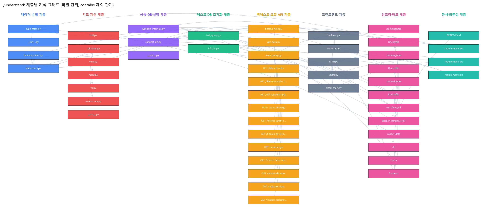
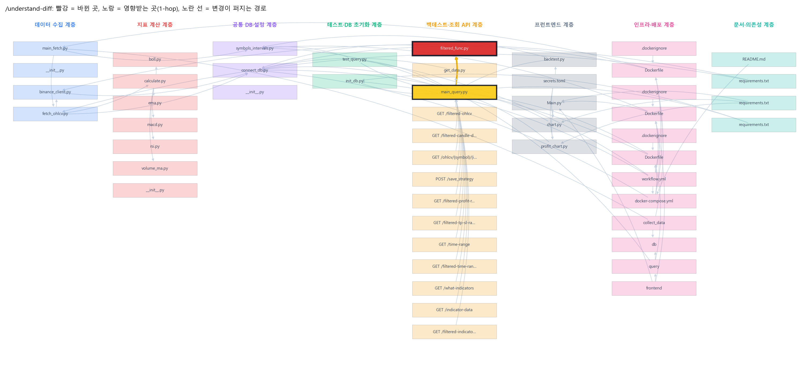

# Dev5ps 구조 분석 (Understand-Anything)

> 이 저장소 코드에 Understand-Anything 가이드의 명령 1~7을 실행한 결과입니다. 8번 `/eli5`는 [02_ELI5_저장소설명.html](02_ELI5_저장소설명.html)에 있습니다.
> 실행일: 2026-10-18

## 0. 어떻게 실행했나

| 항목 | 내용 |
|---|---|
| 분석 대상 | 팀 코드 기준 커밋 `028e087`(2025-06-16)의 파일 36개: Python 23, Dockerfile·.dockerignore 6, docker-compose·workflow 2, README·requirements 4, secrets.toml 1. 이 포크에서 추가한 `docs/`, `.ua/`는 제외 |
| 방법 | **Understand-Anything 플러그인 v2.9.7을 이 저장소에서 직접 실행**(`/understand --language ko`). 플러그인의 스캔·묶음·병합·지문 스크립트와 전문 에이전트(file-analyzer 5개 병렬, assemble-reviewer, architecture-analyzer, tour-builder)가 Phase 1~7 수행 |
| 결과 위치 | `.ua/knowledge-graph.json`(플러그인의 `/understand-dashboard`로 열 수 있음), `.ua/diff-overlay.json`, `docs/ua/ua_results.json`, `docs/img/ua_*.png` |
| 명령 2~7 | 플러그인 각 명령의 절차(그래프 검색 → 1-hop 연결 → 계층 → 원본 코드 대조)를 따라 수행 |
| 참고 | 그래프의 `README.md` 노드 요약은 분석 시점의 팀 README(운영 메모) 기준입니다. 새 README로 갱신하려면 `/understand`를 다시 실행하면 바뀐 파일만 다시 분석합니다 |

---

## 1. `/understand --language ko`

| 결과 | 값 |
|---|---|
| 노드 | **94개** = 파일 23 · 함수 42 · 엔드포인트 11 · 서비스 11 · 문서 4 · 클래스 1 · 파이프라인 1 · 설정 1 |
| 엣지 | **201개** = contains 58 · exports 40 · calls 26 · related 24 · imports 20 · depends_on 16 · deploys 9 · triggers 3 · configures 3 · tested_by 1 · documents 1 |
| 계층 | 8개 |
| 투어 | 10단계 |
| 검증 | 문제 0 · 경고 3(빈 `__init__.py` 3개는 연결이 없음) |



### 아키텍처 계층

| 계층 | 파일 | 역할 |
|---|---|---|
| 데이터 수집 | fetcher/main_fetch.py, binance_client.py, fetch_ohlcv.py | 60초 루프로 Binance 캔들 수집, 테이블 생성·upsert |
| 지표 계산 | indicators/calculate.py, ema, rsi, macd, boll, volume_ma | pandas `ewm`·`rolling`으로 보조지표 계산 |
| 공통 DB·설정 | shared/connect_db.py, symbols_intervals.py | SQLAlchemy 엔진(.env), 코인·간격 목록. **세 서비스가 모두 의존**(connect_db 5곳, symbols_intervals 4곳에서 import) |
| 테스트·DB 초기화 | init_db.py, test_query.py | 샘플 데이터로 스키마 만들고 API를 pytest로 검사 |
| **백테스트·조회 API** | main_query.py, filtered_func.py, get_data.py + 엔드포인트 11개 | 전략 실행·결과 저장·통계·조회 |
| 프런트엔드 | Main.py, pages/backtest.py, chart.py, profit_chart.py, secrets.toml | 전략 입력, 캔들·지표 차트, 수익률·통계 |
| 인프라·배포 | Dockerfile ×3, .dockerignore ×3, docker-compose.yml(+서비스 4), workflow.yml | 컨테이너 구성, CI/CD |
| 문서·의존성 | README.md, requirements.txt ×3 | 실행 메모, 서비스별 패키지 |

### 도메인 흐름 (전략 하나가 지나가는 길)
```
[수집] main_loop(60초) → save_to_db → fetch_from_binance → calculate_indicators → btc_1h 등 테이블 upsert
[입력] backtest.py: 조건 행(session_state) → "rsi > 70 and ema_7 > ema_25" + 손익비 → POST /save_strategy
[실행] save_strategy → run_conditional_lateral_backtest(LEFT JOIN LATERAL) → 수익률·누적수익률 → save_result_to_table(filtered 테이블 초기화 후 저장)
[결과] profit_chart.py → GET /filtered-profit-rate, /filtered-tp-sl-rate(calculate_statics) → 누적수익률 곡선·통계
       chart.py → GET /filtered-ohlcv, /filtered-candle-data, /indicator-data → 거래 구간 캔들·지표
[배포] main push → test(init_db, pytest) → 이미지 3개 빌드·push(Docker Hub) → EC2 SSH 배포
```

### 설계 개념
- **서비스 분리 + 공통 모듈**: 수집·조회·화면을 컨테이너로 나누고 DB 연결과 상수만 `shared/`로 공유
- **계산은 DB에서**: 청산 시점 탐색을 Python 반복문 대신 SQL `LATERAL JOIN` 한 번으로(팀이 반복문 성능 문제를 겪고 바꾼 부분)
- **조회 공통화**: `get_data_from_table`이 컬럼·필터·정렬을 받아 여러 엔드포인트가 재사용
- **결과 테이블은 매번 덮어쓰기**: `filtered`는 "마지막으로 실행한 전략" 하나만 담음

---

## 2. `/understand-knowledge` ― 문서·지식 관계

저장소 문서는 짧은 README와 requirements 3개뿐이라 서로 연결이 없었습니다(모두 고립). 대신 이 프로젝트의 지식 원천인 **발표 자료(5조, 37쪽)의 주장**을 코드 노드와 짝지어 근거를 확인했습니다.

| 발표의 주장(쪽) | 연결된 코드 노드 | 근거 |
|---|---|---|
| Binance에서 실시간 수집·저장 (p12) | main_fetch.main_loop, fetch_ohlcv.save_to_db | 있음(60초 루프, upsert) |
| EMA·RSI·BOLL·MACD로 전략 선택 (p12, 18) | indicators/*, backtest.py | 있음 |
| 수익·승률·기대수익·MDD·통계 제공 (p12, 19, 20) | filtered_func.calculate_statics, /filtered-tp-sl-rate | 있음. 단 **MDD는 %p 기준 계산**, 표준편차 NaN 처리 문제(README 4절) |
| 결과: 4,412회, 승률 26.52%, +2,322.40% (p19) | run_conditional_lateral_backtest | 계산 경로는 있음. 단 **진입 중복을 막지 않아** 한 계좌 기준 수익률로 읽으면 안 됨 |
| test → push → deploy 파이프라인 (p26–28) | workflow.yml → test_query, Dockerfile ×3, docker-compose | 있음 |
| 매수/매도 가격에 닿지 않은 거래의 NaN 처리 (p32) | run_conditional_lateral_backtest의 `np.where(..., 0.0)`, OPEN 결과 | 있음(현재는 OPEN 거래를 수익률 0으로 처리) |
| 반복문 → 팀원 도움으로 SQL 개선 (p32) | 최초 커밋 `d1938d4`의 `iterrows` 루프 → 현재 `LEFT JOIN LATERAL` | 있음(git 기록으로 확인) |

---

## 3. `/understand-explain server-query/filtered_func.py`

> 복잡도 상위(complex)이자 내가 가장 많이 작성한 파일(112줄)입니다. 계층: 백테스트·조회 API.

| 구성 | 하는 일 |
|---|---|
| `run_conditional_lateral_backtest(symbol, interval, strategy_sql, rr, start, end)` | 전략 SQL에 쓰인 지표 이름을 찾아 `what_indicators`로 기록 → 조건을 만족하고 `close > low×1.005`인 봉마다 손절(저가)·익절(종가+손익비×(종가−저가)) 계산 → `LEFT JOIN LATERAL`로 이후 처음 손절/익절에 닿는 봉 찾기(손절 우선) → 수익률·누적수익률(%) 계산 |
| `save_result_to_table(df)` | `filtered` 테이블이 없으면 만들고 **기존 행을 모두 지운 뒤** 저장 |
| `calculate_statics()` | `filtered` 전체를 읽어 실행 횟수, 익절/손절 수, 승률, 기대수익, 수익/손실 분포(평균·표준편차·최소·최대), MDD와 고점·저점 날짜, 최종 수익률 반환 |

**연결**: `main_query.save_strategy`와 `main_query.get_filtered_tp_sl_rate`가 호출하고, `shared/connect_db.py`를 import합니다.

**데이터 흐름**: `strategy_sql`(문자열) → SQL → DataFrame(entry/exit, TP/SL/OPEN) → `profit_rate`(np.where) → `cum_profit_rate`(cumprod) → `filtered` 테이블 → `calculate_statics` → JSON → profit_chart.py의 지표 카드

**처음 보는 사람이 막힐 만한 곳**
- `:rr_ratio`, `:symbol`은 바인딩되지만 `strategy_sql`, `start_time`, `table_name`은 f-string으로 들어갑니다. 같은 쿼리 안에 두 방식이 섞여 있습니다.
- 바깥 쿼리에 `ORDER BY`가 없는데 `cumprod`는 행 순서를 따릅니다.
- `profit_rate`, `cum_profit_rate`는 마지막에 ×100 해서 **퍼센트 단위**로 저장됩니다. 통계 함수에서 다시 `×0.01 + 1`로 자산 배수로 되돌립니다.

---

## 4. `/understand-diff` ― 변경 영향도

이 저장소의 팀 코드는 바꾸지 않았습니다. 그래서 검증에서 찾은 **MDD 계산 수정**을 임시 사본에서만 적용해 분석했습니다. 변경 내용: [verify/mdd_fix_example.diff](verify/mdd_fix_example.diff)

```diff
-    cum_max = df["cum_profit_rate"].cummax()
-    drawdown = df["cum_profit_rate"] - cum_max          # %p 차이
+    df = df.sort_values("entry_time").reset_index(drop=True)
+    equity = 1 + df["cum_profit_rate"] / 100
+    peak = equity.cummax().clip(lower=1.0)              # 원금도 고점 후보
+    drawdown = equity / peak - 1                        # 비율 낙폭
```
수정 확인(같은 검증 스크립트): 예시의 실제 MDD −60%에 대해 기존 −25% → 수정 −60%, 행 순서를 뒤집어도 −60%로 같음.



| 구분 | 결과 |
|---|---|
| 바뀐 곳 | `filtered_func.calculate_statics` |
| 영향받는 곳(1-hop) | `main_query.get_filtered_tp_sl_rate`(→ `GET /filtered-tp-sl-rate`), `filtered_func.py` |
| 걸친 계층 | 백테스트·조회 API 1개 |
| 위험도 | **중간**: 변경은 함수 하나지만 복잡도가 높은 파일이고, 반환 형식(키 이름)은 그대로라 화면 코드는 수정 불필요 |
| 그래프 밖의 영향 | `profit_chart.py`의 "MDD 고점/저점 시점" 의미가 바뀜(원금 시점이 고점이 될 수 있음), 발표 자료의 MDD 수치 재확인 필요 |

---

## 5. `/understand-onboard` ― 새 팀원 가이드

### 읽는 순서 (플러그인 tour-builder 결과)
| 단계 | 제목 | 볼 것 |
|---|---|---|
| 1 | 프로젝트 개요와 서비스 구성 | README, docker-compose.yml |
| 2 | 공유 계층: DB 연결과 상수 | shared/connect_db.py, symbols_intervals.py |
| 3 | 데이터 수집: Binance → PostgreSQL | main_fetch, binance_client, fetch_ohlcv |
| 4 | 보조지표 계산 모듈 | indicators/calculate, rsi, macd, boll, ema |
| 5 | 프런트엔드: 전략 조건 입력 | Main.py, pages/backtest.py |
| 6 | FastAPI 진입점과 `/save_strategy` | main_query.py, StrategyRequest |
| 7 | LATERAL JOIN 백테스트 엔진 | filtered_func.run_conditional_lateral_backtest, save_result_to_table |
| 8 | 통계 계산과 결과 조회 API | calculate_statics, /filtered-tp-sl-rate, /filtered-profit-rate, get_data |
| 9 | 결과 시각화 페이지 | profit_chart.py, chart.py, /indicator-data |
| 10 | 테스트와 CI/CD 배포 | init_db, test_query, workflow.yml |

### 복잡도 상위
| 복잡도 | 파일 | 이유 |
|---|---|---|
| complex | server-query/main_query.py | 엔드포인트 11개, 입력 검증·SQL이 핸들러 안에 섞임 |
| complex | server-query/filtered_func.py | 동적 SQL + LATERAL + 통계 |
| complex | server-frontend/pages/chart.py | 캔들·거래량·지표 서브플롯, 여러 API 조합 |
| moderate | get_data.py, test_query.py, init_db.py, backtest.py, profit_chart.py | 조회 공통화, 테스트 픽스처, 동적 조건 UI |

### 처음 온 사람이 알아야 할 것
- 루트에 `.env`(POSTGRES_*)가 있어야 세 서비스가 DB에 붙습니다. `shared/connect_db.py`가 import 시점에 엔진을 만듭니다.
- `filtered` 테이블은 전략을 실행할 때마다 **지워지고 새로 채워집니다**. 결과를 비교하려면 실행 전에 따로 저장하세요.
- docker-compose가 `./shared` 등을 볼륨으로 덮어씁니다. 이미지만으로 실행하면 frontend Dockerfile의 `COPY shared/ ./shared/symbols_intervals.py` 때문에 import가 깨질 수 있습니다.
- `profit_chart.py`의 기본 API 주소는 8080이고 나머지 페이지는 8082입니다. `secrets.toml`이 없으면 이 페이지만 연결에 실패합니다.

---

## 6. `/understand-chat`

**Q1. 전략 실행 결과(수익률·통계)는 어디서 계산되고 어떤 화면에 표시되나?**
1. `backtest.py`가 조건을 SQL 문자열로 만들어 `POST /save_strategy`로 보냄(depends_on, HTTP)
2. `main_query.save_strategy` → `filtered_func.run_conditional_lateral_backtest`(수익률·누적수익률) → `save_result_to_table`(`filtered`)
3. `profit_chart.py`가 `GET /filtered-profit-rate`(곡선)와 `GET /filtered-tp-sl-rate`(→ `calculate_statics`, 통계 카드)를 호출
4. `chart.py`는 `GET /filtered-ohlcv`로 거래 목록을 받아 구간별 캔들과 `GET /indicator-data`의 지표를 그림
5. 관련 계층: 프런트엔드 → 백테스트·조회 API → 공통 DB

**Q2. 같은 데이터를 여러 서비스가 쓸 때 DB 접속 정보는 어디서 오나?**
`shared/connect_db.py`가 루트 `.env`를 읽어 SQLAlchemy 엔진을 만들고, collect_data·query가 import합니다. docker-compose는 세 서비스에 같은 `.env`를 `env_file`로 넣고, CI에서는 test 단계가 `.env`를 직접 만들어 씁니다.

---

## 7. Language Concepts

| 패턴 | 어디에 | 이 문맥에서 왜 썼나 |
|---|---|---|
| Pydantic 요청 모델 | main_query.py `StrategyRequest(BaseModel)` | `/save_strategy` 본문 JSON의 타입·기본값 검증을 FastAPI에 맡김 |
| FastAPI 데코레이터 라우팅 | `@app.get(...)`, `@app.post(...)` | 함수 하나 = 엔드포인트 하나, `/docs` 자동 생성 |
| SQLAlchemy `text()` + 바인딩 | `:rr_ratio`, `:start`, `:end` | 값은 안전하게 전달. 반면 테이블명·조건식은 f-string이라 인젝션 위험 |
| PostgreSQL `LEFT JOIN LATERAL` | filtered_func.py | 진입 행마다 "그 뒤 첫 청산 봉"을 서브쿼리 하나로 찾음(행 단위 반복을 DB가 처리) |
| `ON CONFLICT ... DO UPDATE` | fetch_ohlcv.py | 같은 시각 캔들을 다시 받아도 중복 없이 지표만 갱신(upsert) |
| `np.where` 중첩 | profit_rate 계산 | TP/SL/OPEN을 반복문 없이 벡터 연산으로 분기 |
| `cumprod` | cum_profit_rate | (1+r₁)(1+r₂)…−1 로 복리 누적수익률 |
| `ewm` / `rolling` | indicators/*.py | 지수이동평균(EMA·MACD)과 단순이동평균·표준편차(볼린저·RSI 시그널) |
| Wilder 평활(RMA) | rsi.py `rma()` | 첫 값은 단순평균, 이후 (이전×(n−1)+현재)/n 으로 누적하는 RSI 원래 정의를 직접 구현 |
| `st.session_state` | backtest.py | Streamlit은 버튼을 누를 때마다 스크립트를 다시 실행하므로, 추가한 조건 행을 상태에 보관 |
| compose `depends_on` + 공유 네트워크 | docker-compose.yml | 시작 순서 지정, 서비스 이름(`query`, `db`)으로 서로 접근 |
| Actions `needs` | workflow.yml | test 성공 → push → deploy 순서 강제 |

---

## 8. 이력서·포트폴리오 관점에서 얻은 것
- **그림**: 계층 그래프(`ua_graph_layers.png`)는 "서비스 구조", diff 오버레이는 "통계 버그 수정의 영향 범위" 장표에 사용 가능. 직접 그린 구조도(`fig_architecture.png`)와 실제 데이터 비교 그림(`fig_backtest_demo.png`)도 함께 사용 가능
- **내 기여 근거**: 커밋 14개, `git blame` 기준 내 작성 줄(filtered_func 112줄 등), 손익점 로직의 최초 구현 → SQL 전환 과정이 git 기록에 남아 있음
- **검증 에피소드**: 내가 작성한 통계 함수의 MDD 공식 오류, NaN 처리, 순서 의존을 작은 예시로 재현하고 수정안까지 확인. 백테스트 결과 해석의 함정(진입 중복)을 찾음
- **개선 후보**: 포지션 중복 방지, 파라미터 바인딩, `ORDER BY`, 수수료 반영, 결과 이력 보관(현재는 매번 덮어씀)
